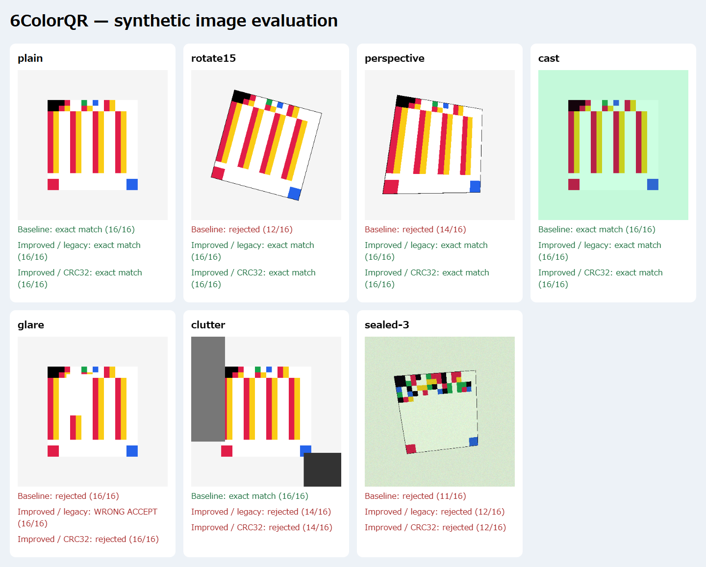

# 6ColorQR 読み取り改善・検証レポート

## 1. 対象と当初の問題

対象は `kmtshn/ColorQRcode` のデフォルトブランチ `genspark_ai_developer`、開始コミットは `0ad37889ee9cbda0354bb3afea03b5a23f9f2167`。作業は `fix/colorqr-scanner-reliability` で行った。README、index.html、manifest.json、sw.jsと直近の修正・マージ履歴を確認した。変更前のアプリは `tests/baseline/index.html` に保存した。

本文を読む前にファインダー16/16で探索を終了すること、最大250候補でCanvasへ再描画すること、回転・射影変換がないことは実装で確認した。HSVは白黒の明度しか補正せず、暗い有彩色を絶対明度で黒にする分岐があった。

XORは長さ、全バイト、固定値0xa5の排他的論理和だった。コメントに反してバイト順には依存しない。recentResultsは使われず、最初の成功フレームで表示していた。READMEの連続フレーム確認、CRC、誤読確率の説明は実装と一致しなかった。

6進4桁から得た256以上の値もUint8Arrayへ代入して下位8ビットへ丸めていた。長さ・UTF-8・XORだけでは非正規のセル列を十分に拒否できなかった。

## 2. 原因分析

四隅は本文より大きな単色領域なので、四隅が一致しても本文セルの中心が合うとは限らない。早期終了により、正しく復元できる候補を試せない。回転するとセルのずれが位置によって変わり、矩形の移動・拡大だけでは補正できない。

候補ごとに再描画する構造は、Canvasへの転送と読み出しを増やす。位置検出と本文復元を分け、1回取得した画素から候補を評価する構造へ変更した。

追加試験では、反射が48バイトの同一文字列の複数バイトを0へ変化させ、XORが相殺された。旧形式の改善エンジンはこの誤りを受理し、同じ画像を2回与えても受理した。時間方向の一致は持続的な反射への対策として十分ではない。

## 3. 実施した改善

フレームを最大辺640pxへ縮小し、Canvasへの描画と画素取得を各1回にした。画像端から推定した背景色との差で領域を抽出し、細い線の欠けを1pxの膨張で接続して連結成分を求める。凸包を四角形へ簡略化し、面積の大きい最大8領域を候補とする。

候補を4方向で評価し、四隅から射影変換を計算する。正規化画像へ再描画する代わりに、16×16セルの標本点を射影する。輪郭の画素化に備え、微小な拡大・縮小も試す。16個のファインダーセルを先に読み、14/16以上で本文を検証する。本文の整合性検査が成功した候補を優先し、失敗した後も次候補を試す。

外周がつながらない旧コード向けに、ガイド枠の位置・スケール候補125個を補助探索する。前回の成功位置を次フレームで最初に評価し、失敗すればその場で再検出する。異なる解像度の位置は再利用しない。

各セル中央の9点からチャンネルごとの中央値を取る。白・黒の基準でRGB各チャンネルのオフセットと利得を補正し、赤・青は実測色、黄・緑は既定色との距離で分類する。低コントラストや画面外の標本は拒否する。非線形の色変換や局所反射を完全に補正する方式ではない。

復元時にはグリッド形状、6進記号範囲、バイト範囲、長さ、チェック値、UTF-8、未使用セルのゼロ埋めを検証する。旧生成器のゼロ埋めと互換である。未使用セルを独自に変える外部実装との互換性は保証しない。

異なるvideo.currentTimeのフレームで同じ内容を2回続けて復元したら表示する。失敗・異なる内容・停止・クリアで確認状態をリセットする。DBGには推定四隅、分類グリッド、整合性結果、処理時間、候補数、失敗理由を追加した。

Service Workerにscanner.jsを追加し、一式を取得できなければ新キャッシュのインストールを失敗させる。このアプリの名前を持つ旧キャッシュだけを削除する。manifest.jsonは変更していない。実行時の依存ライブラリは増やしていない。

## 4. 整合性方式と互換性

以下のセル費用は既存の1バイト4セル表現を使う設計値であり、速度の実測比較ではない。

|方式|追加セル|誤り検出|修復|処理と互換性|
|---|---:|---|---|---|
|従来XOR|0|順序交換や相殺を見逃す|なし|低負荷、現行形式|
|CRC-16追加|8|相殺への検出を強化|なし|形式識別が必要、演算はバイト列長に比例|
|CRC-32追加|16|今回の反射による誤読を拒否|なし|形式識別が必要、演算はバイト列長に比例|
|Reed-Solomon追加|パリティ1バイトにつき4|構成と別途の検証に依存|符号設計の範囲内で可能|有限体演算と復号器が必要、未実装・未測定|

CRCは誤り検出であり、失われた情報を修復しない。CRC-32の多項式・反転処理は [RFC 1952のCRC例](https://www.rfc-editor.org/rfc/rfc1952#section-8) と整合する方式を独自実装した。Reed-Solomonの消失復元の背景は [RFC 5510](https://www.rfc-editor.org/rfc/rfc5510) を参照した。無作為な誤りの仮定をカメラの系統的な誤りへそのまま適用しない。CRCは改ざんへの認証でもない。

旧形式だけでも基本160件は全て復元したが、追加試験で誤読が見つかったため新規生成にCRC-32を採用した。Reed-Solomonは別の復号器と誤修復の検証が必要になるため、今回は導入していない。

新形式は先頭3セルを64＋UTF-8バイト長（64〜112）とし、旧形式の0〜48と区別する。従来のXORフィールドと本文の後に、[2, 長さ, 本文バイト列]のCRC-32を上位から4バイト、各4セルで置く。残りはゼロ埋めする。それ以外の長さタグは拒否する。

48バイト時はヘッダー7＋本文192＋CRC16＝215セルを使い、25セルが残る。従来の余白41セルの一部を使うため公開上限48バイトは変わらない。理論上の余裕は58バイト相当から54バイト相当になるが、その容量を公開していない。旧コードを新リーダーで読める一方、新コードは旧リーダーでは読めない。生成画面に更新が必要であることを表示した。

## 5. 改善前後の測定

WindowsのEdge 156.0.4314.42をPlaywrightから起動し、Canvas画像を実際の画像処理関数へ注入した。旧版は保存原本のsearchBestRectとdecodeGridToTextを使った。旧形式の比較は同一文字列・同一セル列・同一変形・同一乱数種を使う。CRC形式は同じ撮影条件へ新形式を適用するため、画素は旧画像と同一ではない。

原本を先に測定し、その後エンジンを変更した。開発100件、容量48件、初期評価12件に加え、回転・遠近・色・ノイズを組み合わせた追加評価24件と厳しい条件18件を用意した。不正画像10件は復元率の分母から除き、誤受理を別に集計した。

初期評価12件は最初の診断にも参照したため、完全な未見評価とは呼ばない。追加評価24件は輪郭エンジン修正後に固定し、結果に合わせた位置・色のパラメーター調整はしていない。その後、厳しい条件の誤読を根拠にCRC形式を追加した。外部の自然画像集合や完全な二重盲検による評価ではない。

|指標|現行版・旧形式|改善版・旧形式|改善版・CRC32|
|---|---:|---:|---:|
|正確な復元|124/202（61.4%）|187/202（92.6%）|187/202（92.6%）|
|誤った内容の受理|0/212|1/212|0/212|
|平均処理時間|102.0ms|13.2ms|15.1ms|
|中央値|58.9ms|9.5ms|10.9ms|
|p95|213.3ms|29.1ms|34.8ms|
|正面・無加工|53/53|53/53|53/53|
|±5/10/15度の回転|0/30|30/30|30/30|
|台形ゆがみ|0/5|5/5|5/5|
|日本語を含む有効画像|16/42|35/42|35/42|
|追加評価24件|0/24|19/24|19/24|
|厳しい条件18件|11/18|8/18|8/18|

時間は各画像を1回ずつ処理した実測で、改善版の追跡状態を画像ごとにリセットした。画像生成を除き、描画・画素取得・検出・復元を含む。JIT・GC・実行順序を統制した反復性能試験ではない。追跡成功時の中央値は旧形式1.6ms、新形式1.9msだった。スマートフォンの性能には換算していない。

旧アプリは1フレーム、新アプリの確認器は成功画像を繰り返して2フレームで確定した。これは静止画像を2回与えた試験であり、実カメラの成功フレーム数は未測定。200msのスキャン間隔があるため、処理時間と表示待ち時間も別である。

performance.memoryが返した測定終了時のJSヒープ値はJSONへ保存した。GC時点、Canvas・GPU・カメラの消費を統制できていないため、メモリの改善率は算出していない。

全条件は [実測比較](results/COMPARISON.md)、画像ごとの座標、スコア、復元値、失敗理由、時間はresults内のJSONに残した。初回の旧形式改善測定もimproved-legacy-initial.jsonに保存した。

## 6. 成功した条件と失敗した条件

正面、上下左右26pxの移動、0.8〜1.2倍、定型回転±15度まで、設定した台形変形、1.6pxのぼかし、RGB各±23のノイズ、0.3倍の明度、チャンネル別の色かぶり、彩度低下、軽い色相変化の基本条件は改善版で全て復元した。1〜48バイトも各長さで復元した。色相変化はRGB混合による軽い変換で、広い色相角の網羅試験ではない。

複合変形の追加評価は19/24件だった。失敗画像は長さ・チェック値・バイト値の検証エラーを示した。候補座標のJSONと画像を残しており、輪郭の線分当てはめと四隅の再推定を改善する余地がある。

明度0.07倍は新旧とも0/3件だった。改善版はファインダーのコントラスト不足を拒否した。白く塗った反射・遮蔽では失われた本文を修復できない。短い1バイトの画像が読めたのは、白塗りが既に白い未使用領域に重なるためで、修復したわけではない。

背景物体を外周へ接触させた3件は旧版3/3から改善版0/3へ悪化した。成分が背景と結合して凸包が変わることに加え、物体がファインダーへ重なりRGB基準色を汚す。旧版のHSVは有彩色の明度への依存が小さく、この設定では復元できた。改善版のガイド補助探索でも同じ基準色が汚れるため回復しない。探索範囲の拡大だけでは不十分であり、局所的なマーカー検出と基準色の外れ値排除が必要である。この回帰は未解決として残した。

## 7. 自動テストと未実施項目

回帰テストは12グループを実行した。新旧の0〜48バイト、日本語と絵文字、範囲外バイト、不正グリッド、パディング、UTF-8、CRC参照値、XOR衝突、CRCでの順序交換拒否、単一記号置換1200通りの拒否を確認した。実際の生成関数の画像を0・±5・±10・±15・90・180度で読み、誤候補と正候補が同居する画像、連続確認、追跡解除、PWAのオフライン再読み込みも検証した。Canvas由来の合成MediaStreamをカメラ入力へ注入し、実際のスキャン処理と結果表示まで動作を確認した。実機のカメラ映像ではない。

最初のサンドボックス内ブラウザー起動と依存導入は失敗した。権限を切り替えた実行で導入・Edge起動・測定を完了した。失敗した起動をテスト成功には含めていない。

Android Chrome、iOS Safari、WebKit、実カメラ動画、印刷物の実写、液晶のモアレ、レンズ歪み、ローリングシャッター、長時間の発熱とメモリ、端末間の性能差は未検証。大量の自然画像に対する誤検出率も未測定。合成画像の改善を実機の完成保証とは扱わない。

## 8. スマートフォン実機で確認する手順

1. このブランチをHTTPSで配信し、Android ChromeとiOS Safariで読み込む。キャッシュがv3へ更新された後に再読み込みする。マイクの許可は不要。
2. 保存済みの旧PNGと、新規生成したCRC形式を別画面と非光沢紙で用意する。ASCII、日本語、数字、URL、48バイトを含め、表示内容を原文と完全一致で照合する。
3. 正面から開始し、位置、距離、±5/10/15度、斜め撮影、反射、暗さ、色温度、背景接触を順に変える。四隅と余白を入れた場合と外した場合を分ける。
4. DBGの四隅、グリッド、失敗理由、時間を記録し、撮影開始から成功までのフレーム数と待ち時間を数える。復元しない画像と誤内容を表示する画像を分けて記録する。
5. 別コードへの移動、停止、カメラ切替、バックグラウンド復帰を試す。失敗を挟むと確認がリセットされることも調べる。
6. ホーム画面へ追加し、通信を切って再起動する。生成と読み取りが動き、ネットワーク記録に映像・入力の送信がないことを確認する。
7. 数分間の連続使用で応答時間、端末温度、バッテリー、画面回転、低電力モードの変化を記録する。

## 9. 完成度と今後の改善

今回は、合成画像による比較測定が可能な改善実装まで完了した。実機リリース検証は未完了。正面100%と基本の回転・遠近耐性を満たし、全体の復元率と処理時間を改善した。旧形式の反射による誤読、背景接触の回帰、複合変形の失敗は残る。

次は同意を得て収集したローカル実機動画を評価用に分離し、輪郭の線分当てはめ、マーカーの独立検出、基準色の外れ値処理を比較する。黄・緑の基準不足、非線形ガンマ、局所照明の補正も検討する。その後、消失位置の信頼度を使うReed-SolomonとCRCを併用し、修復で増える成功と誤修復を別々に測る。追加ライブラリのサイズと速度は採用前に実測する。
